<div align="center">

<svg width="64" height="64" viewBox="0 0 24 24" fill="none" xmlns="http://www.w3.org/2000/svg">
  <rect width="24" height="24" rx="6" fill="url(#grad)" />
  <path d="M4 4H20V8H4V4Z" fill="#ffffff" fill-opacity="0.2"/>
  <path d="M4 8L7 4M10 8L13 4M16 8L19 4" stroke="#ffffff" stroke-width="1.5" stroke-linecap="round"/>
  <polygon points="9.5 11 15.5 14.5 9.5 18" fill="#ffffff"/>
  <defs>
    <linearGradient id="grad" x1="0" y1="0" x2="24" y2="24" gradientUnits="userSpaceOnUse">
      <stop stop-color="#7c5cff"/><stop offset="1" stop-color="#f5b942"/>
    </linearGradient>
  </defs>
</svg>

# CineMatch

**Discover movies in every language: Hollywood, Bollywood, Gujarati and South Indian cinema, with a hybrid content + quality recommender**

[](https://cinematch-ocr0.onrender.com)
[](https://python.org)
[](https://flask.palletsprojects.com/)
[](https://react.dev)
[](https://vitejs.dev)
[](https://web.dev/progressive-web-apps/)
[](https://www.themoviedb.org)

👉 **[Launch Live Demo (https://cinematch-ocr0.onrender.com)](https://cinematch-ocr0.onrender.com)**

> ⏳ *Hosted on a free tier: the first visit after idle time can take about a minute to wake up.*

<table>
  <tr>
    <td width="72%" align="center"><b>Desktop Experience (1440×900)</b></td>
    <td width="28%" align="center"><b>Mobile Experience (390×844)</b></td>
  </tr>
  <tr>
    <td valign="top">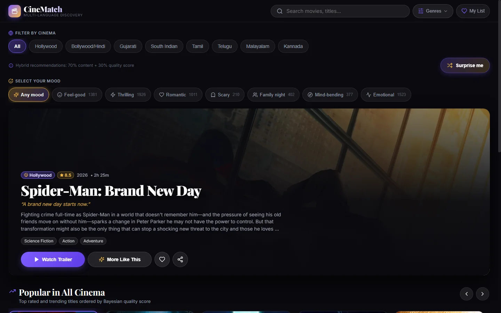</td>
    <td valign="top"></td>
  </tr>
</table>

</div>

---

## 📑 Table of Contents
- [✨ Features](#features)
- [📸 Screenshots Gallery](#screenshots-gallery)
- [⚙️ How It Works](#how-it-works)
- [🏗️ Architecture & Tech Stack](#architecture-and-tech-stack)
- [📡 API Reference](#api-reference)
- [🚀 Getting Started](#getting-started)
- [☁️ Deployment on Render](#deployment-on-render)
- [📁 Project Structure](#project-structure)
- [📊 By the Numbers](#by-the-numbers)
- [⚠️ Limitations](#limitations)
- [🗺️ Roadmap](#roadmap)
- [📜 Credits & Attribution](#credits-and-attribution)

---

## ✨ Features

- 🔍 **Discovery & Search**: Global smart search across all 3,893 titles. Normalized (Unicode NFKD, accents stripped, space & punctuation insensitive) with 5 matching tiers and fuzzy fallback (`difflib.SequenceMatcher` $\ge 0.8$). Full keyboard navigation (`ArrowUp`, `ArrowDown`, `Enter`, `Escape`).
- 🎯 **Recommendations**: Fixed 70/30 hybrid recommendation model blending content similarity with Bayesian rating and popularity. Automatically yields two distinct rows: **"Because you picked..."** (same original language) and **"Similar in other languages"** (cross-cinema thematic matches).
- 🎬 **Multi-Language Trailers**: In-modal trailer switcher with smart YouTube embeds (`youtube-nocookie.com`). Displays chips for all available language dubs/originals; offers fallback YouTube search when an official dub is not in TMDB.
- 🌐 **Browse by Language, Genre & Mood**:
  - Single-select cinema chips: Hollywood (`en`), Bollywood/Hindi (`hi`), Gujarati (`gu`), Tamil (`ta`), Telugu (`te`), Malayalam (`ml`), Kannada (`kn`), and unified South Indian.
  - 19 catalog genres with live count badges and a reset action.
  - 7 curated mood presets (Feel-good, Thrilling, Romantic, Scary, Family night, Mind-bending, Emotional) with live counts.
- ⭐ **Personal Features**:
  - **Favourites & My List**: Slide-out drawer to curate a personal watchlist stored in browser `localStorage`.
  - **Picked for You**: Personalized hybrid recommendations generated on the fly from the user's top favourites with recency weighting.
  - **Surprise Me**: One-click serendipitous pick from a high-quality movie pool respecting the active language/genre/mood filter without resetting state.
- 🔗 **Sharing & Installable App**:
  - Shareable movie links (`/?movie=<id>`) with dynamic server-side Open Graph and Twitter Card tags.
  - Progressive Web App (PWA) with Web App Manifest, maskable icons, and a custom Service Worker for offline fallback.
- 📱 **Mobile-First UI**: Cinematic dark theme (`#0a0a0f`), edge-to-edge trailer player on phones, 44×44px tap targets, and responsive layout across 360px, 390px, 412px, and desktop viewports.
- ⚡ **Performance**: 194 MB real memory RSS, sub-millisecond dynamic SSR tag injection, and sparse `float32` vector calculations. Zero runtime TMDB calls.

[Back to top](#cinematch)

---

## 📸 Screenshots Gallery

<table>
  <tr>
    <td width="50%" align="center"><b>Two-Row Hybrid Recommendations</b><br/>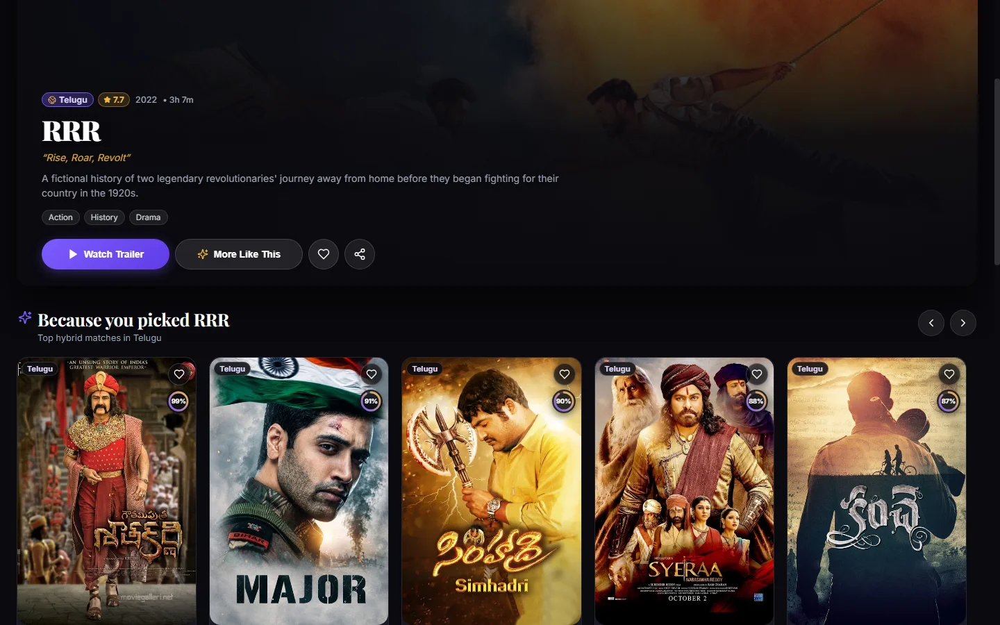</td>
    <td width="50%" align="center"><b>Multi-Language Trailer Modal</b><br/>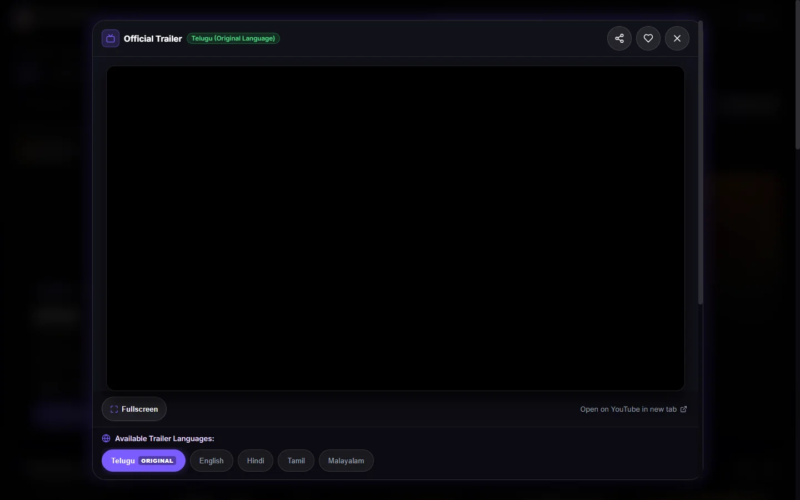</td>
  </tr>
  <tr>
    <td width="50%" align="center"><b>Instant Global Search (Keyboard Nav)</b><br/></td>
    <td width="50%" align="center"><b>Curated Mood Discovery Grid</b><br/>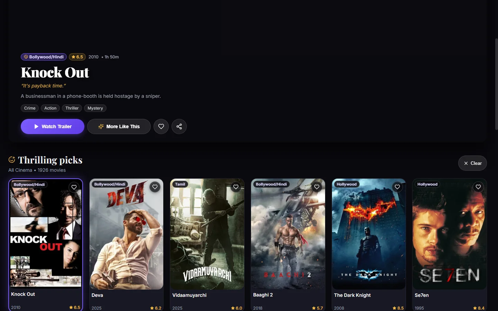</td>
  </tr>
  <tr>
    <td width="50%" align="center"><b>Genre Catalog Browser</b><br/>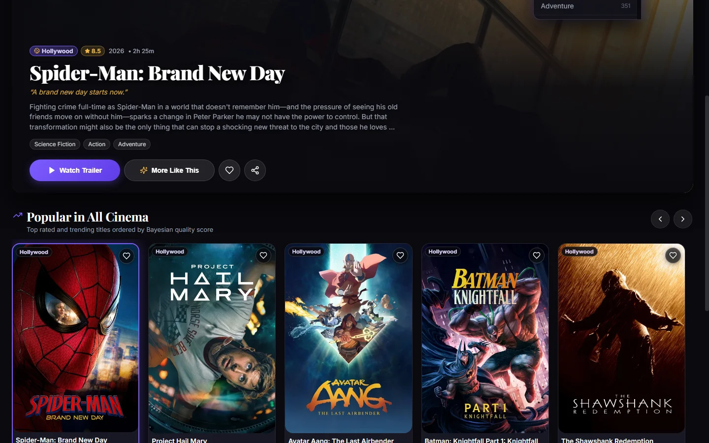</td>
    <td width="50%" align="center"><b>My List Watchlist Drawer</b><br/>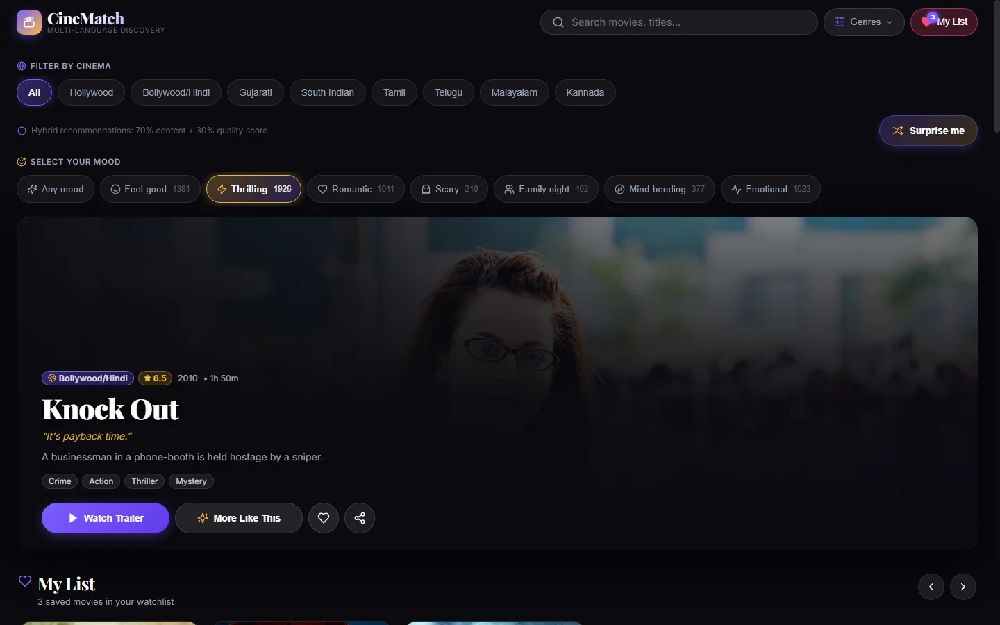</td>
  </tr>
</table>

<details>
<summary><b>📱 View Mobile Experience Screenshots (Click to expand)</b></summary>
<br/>
<table>
  <tr>
    <td width="25%" align="center"><b>Search Panel</b><br/>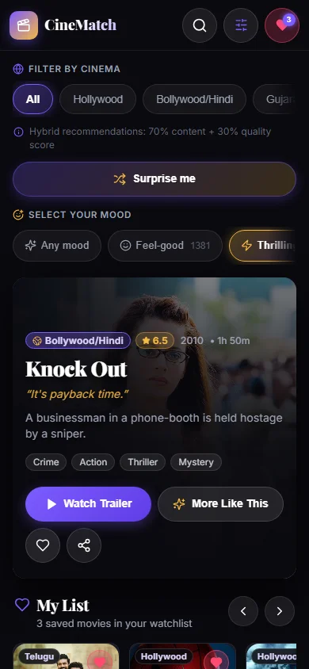</td>
    <td width="25%" align="center"><b>Edge Player</b><br/>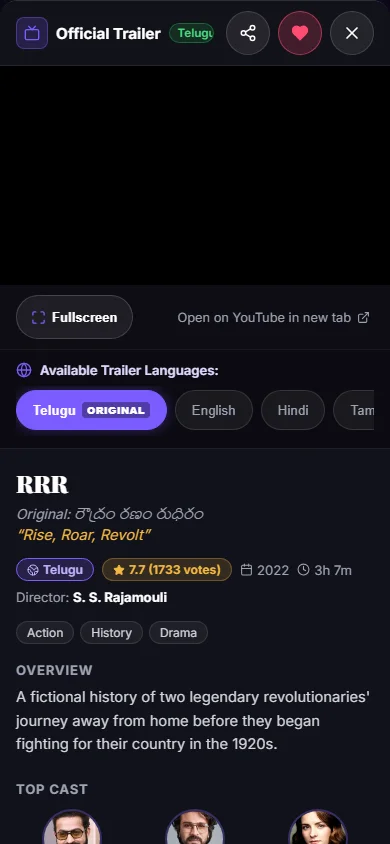</td>
    <td width="25%" align="center"><b>My List Drawer</b><br/>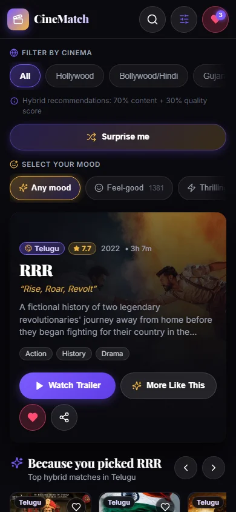</td>
    <td width="25%" align="center"><b>Footer & Credits</b><br/>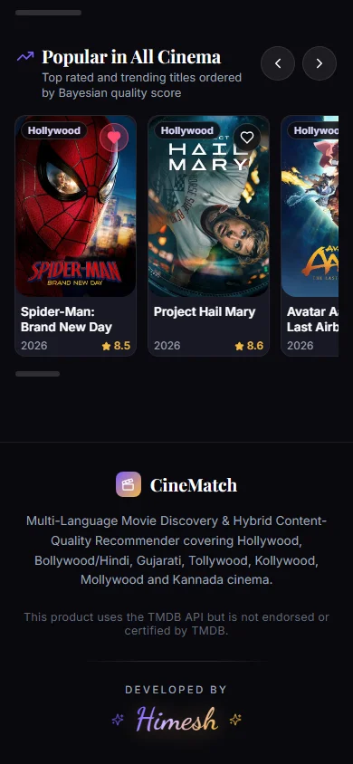</td>
  </tr>
</table>
</details>

[Back to top](#cinematch)

---

## ⚙️ How It Works

### Data Pipeline
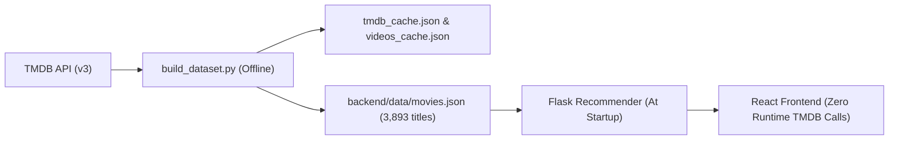
All metadata is built offline using `backend/build_dataset.py` with multi-threading and persistent disk caching (`tmdb_cache.json`, `videos_cache.json`). The live web application requires **zero external API calls at runtime**.

### Hybrid Recommender Engine
The engine combines content similarity with an IMDb-style Bayesian quality metric:
$$\text{Final Score} = 0.70 \times S_{\text{content}} + 0.30 \times S_{\text{quality}}$$

#### 1. Content Similarity ($S_{\text{content}}$)
Document representation built from weighted metadata: **Genres** ($3\times$), **Keywords** ($2\times$), **Director** ($1\times$), **Top 4 Cast Members** ($1\times$), and **Overview Text** ($1\times$). Fitted using `TfidfVectorizer` (`ngram_range=(1, 2)`, `sublinear_tf=True`, `max_features=12000`, `dtype=float32`). Candidate similarity is computed on demand via sparse dot product and min-max normalized to $[0, 1]$:
$$\text{sim}(m_t, m_i) = v_t \cdot v_i^T$$

#### 2. Bayesian Quality Score ($S_{\text{quality}}$)
Combines weighted ratings with log-scaled popularity:
$$WR = \left(\frac{v}{v + m}\right) R + \left(\frac{m}{v + m}\right) C \quad , \quad P_{\log} = \ln(1 + \text{popularity})$$
where $v$ is vote count, $R$ is vote average, $C \approx 6.0$ is catalog mean, and $m \ge 5.0$ is the 35th percentile threshold. Normalized blend:
$$S_{\text{quality}} = \text{norm}(0.65 \times WR_{\text{norm}} + 0.35 \times P_{\log,\text{norm}})$$
Scores are scaled to user-facing match percentages ranging from **65% to 99%**, outputting two distinct rows: **"Because you picked..."** (same original language) and **"Similar in other languages"** (other languages).

### Smart Search & Normalization
Titles and queries are normalized: Unicode NFKD (diacritics stripped: *Bāhubali* $\rightarrow$ *Bahubali*), case folding, symbol replacement (`&` $\rightarrow$ `and`), punctuation stripping, and leading article removal (*The*). Matched across 5 progressive tiers:
1. **Tier 1**: Exact compact match (`"rrr"` $\rightarrow$ *RRR*).
2. **Tier 2**: Prefix compact match (`"spid"` $\rightarrow$ *Spider-Man*).
3. **Tier 3**: Token-prefix match (`"dark kni"` $\rightarrow$ *The Dark Knight*).
4. **Tier 4**: Compact substring (`"man brand"` $\rightarrow$ *Spider-Man: Brand New Day*).
5. **Tier 5**: Fuzzy fallback using `difflib.SequenceMatcher` ($\ge 0.8$) triggered only when fewer than 8 matches exist.
*Examples matching Spider-Man*: `Spider-Man`, `spider man`, and `spiderman`.

### Trailer Language Chips & Curated Moods
- **Trailer Chips**: Original language is always first (`ORIGINAL`). On **All / Hollywood (`en`)**, `en`, `hi`, `ta`, and `te` chips are always present, with `ml`, `kn`, `gu` shown if a TMDB video exists. On **South Indian chips**, `hi` and all South languages are available. Clicking an unbundled chip triggers an instant YouTube trailer search query.
- **Mood Presets**:
  - **Feel-good**: Any `Comedy, Family, Animation` | Exclude `Horror, War, Crime`
  - **Thrilling**: Any `Thriller, Action, Crime, Mystery` | Exclude `Family, Animation`
  - **Romantic**: Any `Romance` | Boost `Drama, Comedy`
  - **Scary**: Any `Horror` | Boost `Thriller, Mystery`
  - **Family night**: Any `Family, Animation` | Exclude `Horror` | Boost `Adventure, Comedy`
  - **Mind-bending**: Any `Science Fiction, Mystery` | Boost `Thriller`
  - **Emotional**: Any `Drama` | Exclude `Horror, Action` | Boost `Romance`
- **Picked for You & Surprise Me**: Recency decay ($w_k = 10 - k$) over 10 recent favourites. Surprise Me samples from a curated quality pool ($vote\_average \ge 6.5, vote\_count \ge 100$).
- **PWA Caching**: Network-first with `/offline.html` fallback for navigation. Cache-first only for hashed `/assets/*`. Never caches `/api/*`.

[Back to top](#cinematch)

---

## 🏗️ Architecture and Tech Stack

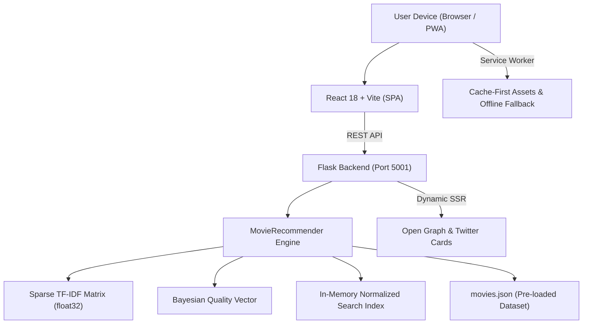

| Layer | Technologies | Role & Implementation |
| :--- | :--- | :--- |
| **Backend** | Python 3.10+, Flask, Gunicorn, Waitress | REST API, Werkzeug `ProxyFix`, SSR metadata injection |
| **Frontend** | React 18, Vite 5, Tailwind CSS, Lucide React | Single Page Application, responsive components, PWA manifest |
| **Data & ML** | NumPy, scikit-learn, Requests | TF-IDF sparse vectorization, Bayesian quality ranking |
| **Hosting** | Render (Web Service), PWA Service Worker | Cloud deployment, client-side offline fallback |

[Back to top](#cinematch)

---

## 📡 API Reference

| Method | Endpoint | Parameters | Description |
| :--- | :--- | :--- | :--- |
| `GET` | `/api/health` | None | Service status, total movies, available languages |
| `GET` | `/api/languages` | None | Supported cinema codes with movie counts |
| `GET` | `/api/popular` | `languages`, `n` (default 12) | Top Bayesian quality-ranked movies |
| `GET` | `/api/search` | `q` (required), `limit` (default 10) | Multi-tier global search across catalog |
| `GET` | `/api/genres` | `languages` | Genre distribution for active language selection |
| `GET` | `/api/moods` | `languages` | Movie counts across 7 curated moods |
| `GET` | `/api/browse` | `genre` \| `mood`, `languages`, `offset`, `limit` | Paginated catalog browser by genre or mood |
| `GET` | `/api/recommend` | `movie_id` (required), `languages`, `n`, `alpha` | Two-row hybrid recommendations |
| `GET` | `/api/movie/<id>` | Movie ID (in path) | Full details with cast, crew, trailers |
| `POST` | `/api/cards` | JSON `{"ids": [...]}` | Batch retrieval of movie cards |
| `POST` | `/api/for_you` | JSON `{"ids": [...], "n": 12, "languages": "..."}` | Personalized recommendations from favourites |
| `GET` | `/api/surprise` | `languages`, `genre`, `mood`, `exclude` | High-quality random movie pick |

<details>
<summary><b>📋 View Sample API Response: /api/search?q=spiderman (Click to expand)</b></summary>

```json
[
  {
    "id": 557,
    "title": "Spider-Man",
    "original_title": "Spider-Man",
    "year": 2002,
    "language": "en",
    "language_name": "Hollywood",
    "genres": ["Action", "Science Fiction"],
    "poster_url": "https://image.tmdb.org/t/p/w500/or6XJBVpcEbIkma0V9zshnbEtx4.jpg",
    "backdrop_url": "https://image.tmdb.org/t/p/w1280/sWvxBXviRvxKqfgW3Ac5GYmxwXh.jpg",
    "tmdb_rating": 7.3,
    "runtime": 121
  }
]
```
</details>

<details>
<summary><b>📋 View Sample API Response: /api/recommend?movie_id=579974 (Click to expand)</b></summary>

```json
{
  "same_language": [
    {
      "id": 434395,
      "title": "Gautamiputra Satakarni",
      "year": 2017,
      "language": "te",
      "language_name": "Telugu",
      "genres": ["History", "Drama", "Action"],
      "match_percent": 96
    }
  ],
  "other_languages": [
    {
      "id": 693134,
      "title": "Dune: Part Two",
      "year": 2024,
      "language": "en",
      "language_name": "Hollywood",
      "genres": ["Science Fiction", "Adventure"],
      "match_percent": 88
    }
  ]
}
```
</details>

[Back to top](#cinematch)

---

## 🚀 Getting Started

### Prerequisites
- **Python 3.10+** | **Node.js LTS** (v18+) | **Git**

### Quickstart (Windows One-Click)
Double-click `run.bat` in the repository root. It sets up the virtual environment, verifies dependencies, and launches both services:
- **Frontend (Vite Dev)**: `http://localhost:5174` | **Backend (API)**: `http://127.0.0.1:5001`

### Manual Setup
1. **Clone repository & configure environment**:
   ```bash
   git clone https://github.com/your-username/cinematch-multilang.git
   cd cinematch-multilang
   python -m venv venv
   # On Windows: .\venv\Scripts\activate | On macOS/Linux: source venv/bin/activate
   pip install -r backend/requirements.txt
   cp backend/.env.example backend/.env
   ```
   *(Note: `TMDB_API_KEY=your_key_here` is only required if rebuilding the dataset; the full 3,893-movie dataset is already bundled).*

2. **Frontend build & development**:
   ```bash
   cd frontend
   npm install
   npm run build    # Compiles to frontend/dist for production SSR serving
   npm run dev      # Launches dev server on port 5174
   ```

3. **Start backend (Port 5001)**:
   ```bash
   cd backend
   python app.py
   ```

### Rebuilding Dataset (Optional)
```bash
python backend/build_dataset.py
```
*Resumes automatically from `backend/data/tmdb_cache.json` and `backend/data/videos_cache.json` using 6 parallel workers.*

[Back to top](#cinematch)

---

## ☁️ Deployment on Render

CineMatch is configured for zero-config deployment on Render via [`render.yaml`](render.yaml):
- **Build Command**: `pip install -r backend/requirements.txt`
- **Start Command**: `gunicorn --chdir backend app:app --bind 0.0.0.0:$PORT --workers 1 --threads 4 --timeout 120`
- **Static Assets**: Pre-compiled `frontend/dist` and `movies.json` are committed to git; no external TMDB key is required at runtime.
- **Resource Footprint**: Consumes **~195 MB RAM** (comfortably within Render's 512 MB free tier). Auto-sleeps during idle periods.
- **Continuous Deployment**: Automatically deploys upon pushing to `main`.

[Back to top](#cinematch)

---

## 📁 Project Structure

```
cinematch-multilang/
├── backend/
│   ├── app.py                 # Flask REST API, SSR Open Graph injection, PWA routes
│   ├── recommender.py         # TF-IDF vectorizer, Bayesian quality scoring, smart search
│   ├── build_dataset.py       # Offline TMDB data ingestion and cache builder
│   ├── requirements.txt       # Production Python dependencies
│   ├── .env.example           # Template environment variable (TMDB_API_KEY)
│   └── data/
│       ├── movies.json        # Bundled movie catalog (3,893 titles)
│       ├── tmdb_cache.json    # Cached movie details from TMDB
│       └── videos_cache.json  # Cached multi-language trailer keys
├── frontend/
│   ├── index.html             # HTML shell with PWA tags and fallback meta
│   ├── vite.config.js         # Vite configuration with /api proxy (port 5174 -> 5001)
│   ├── public/
│   │   ├── manifest.webmanifest # PWA Web App Manifest
│   │   ├── sw.js              # Service Worker (network-first, offline fallback)
│   │   ├── offline.html       # Offline fallback UI
│   │   └── og-image.png       # 1200x630 social preview card
│   └── src/
│       ├── App.jsx            # Main app shell, query router, state coordinator
│       ├── main.jsx           # React root & service worker registration
│       ├── context/           # FavoritesContext (localStorage sync)
│       └── components/        # Navbar, Hero, Carousel, DetailModal, ShareButton, etc.
├── docs/
│   └── screenshots/           # Fresh WebP screenshots for documentation
├── render.yaml                # Render Web Service blueprint
└── run.bat                    # Windows one-click local launcher
```
*(Development and verification scripts are retained locally for testing).*

[Back to top](#cinematch)

---

## 📊 By the Numbers

| Metric | Measured Value | Details |
| :--- | :--- | :--- |
| **Total Catalog Size** | **3,893 movies** | Across 7 Indian and international cinemas |
| **Hindi Cinema (`hi`)** | **1,262 titles** | Bollywood blockbusters & classics |
| **Hollywood (`en`)** | **591 titles** | Global English-language releases |
| **Tamil Cinema (`ta`)** | **500 titles** | Kollywood popular releases |
| **Telugu Cinema (`te`)** | **500 titles** | Tollywood popular releases |
| **Malayalam Cinema (`ml`)** | **500 titles** | Mollywood acclaimed cinema |
| **Gujarati Cinema (`gu`)** | **397 titles** | Regional Gujarati industry titles |
| **Kannada Cinema (`kn`)** | **143 titles** | Sandalwood popular releases |
| **Catalog Genres** | **19 distinct** | Action, Comedy, Drama, Sci-Fi, Horror, etc. |
| **Curated Moods** | **7 moods** | Pre-computed Boolean genre masks |
| **Dataset Size** | **8.58 MB** | Fully bundled in `backend/data/movies.json` |
| **Search Latency** | **7.99 ms** | Average over 20 varied queries |
| **Runtime Memory (RSS)**| **194.45 MB** | Under production Waitress / Gunicorn worker |

[Back to top](#cinematch)

---

## ⚠️ Limitations

- **Regional Data Availability**: TMDB has fewer catalog entries for regional languages (e.g. Gujarati) compared to Hollywood or Bollywood.
- **Trailer Coverage**: Embedded trailers depend on official uploads on TMDB; for unbundled languages, CineMatch provides a direct YouTube search fallback.
- **Client-Side Storage**: Favourites and watchlists are stored in browser `localStorage`. No cloud accounts or user profiles are required.
- **Free-Tier Wake Up**: On Render's free tier, the instance spins down after periods of inactivity and may require 45–60 seconds to resume.

[Back to top](#cinematch)

---

## 🗺️ Roadmap

- [x] Multi-language discovery across 7 Indian and international cinema industries
- [x] Fixed 70/30 hybrid recommender (content similarity + Bayesian quality)
- [x] Two-row recommendation display (same language vs cross-language)
- [x] Multi-language in-modal YouTube trailer switcher
- [x] Instant normalized search with 5 matching tiers and keyboard navigation
- [x] Curated mood picker with Boolean genre masks
- [x] Favourites & My List drawer with localStorage persistence
- [x] "Picked for you" personalized recommendation engine
- [x] "Surprise me" quality-filtered random picker
- [x] Dynamic server-rendered Open Graph & Twitter Cards for share links
- [x] Progressive Web App (PWA) with offline fallback
- [ ] Multi-select language filtering combinations
- [ ] User review sentiment analysis
- [ ] Export watchlist to Letterboxd / CSV

[Back to top](#cinematch)

---

## 📜 Credits and Attribution

This product uses the TMDB API but is not endorsed or certified by TMDB.

Movie metadata and imagery courtesy of [The Movie Database (TMDB)](https://www.themoviedb.org/).

<div align="center">
  <sub>Developed by Himesh</sub>
</div>
